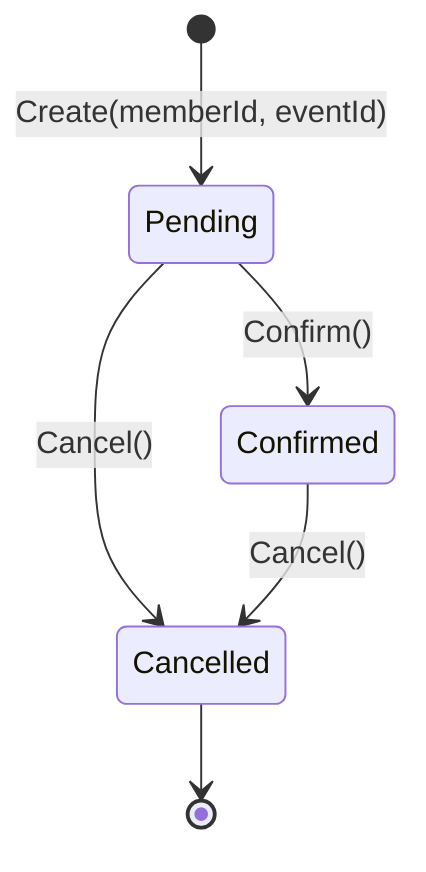
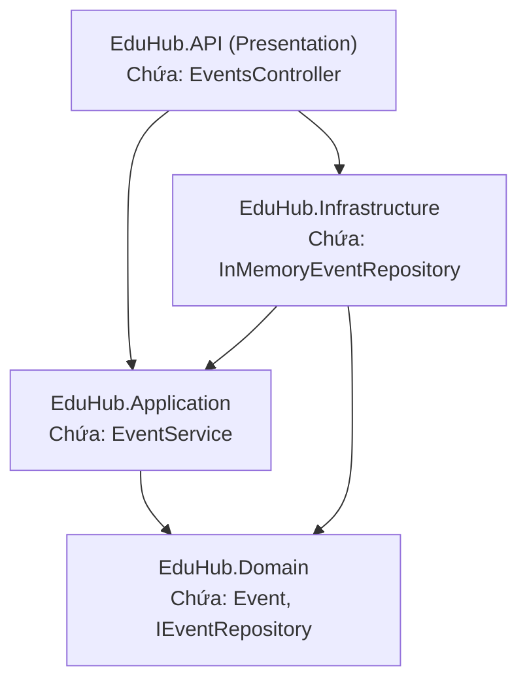

## Câu 1a

Bốn trụ cột của lập trình hướng đối tượng (OOP):

1. **Đóng gói (Encapsulation):** Gom dữ liệu (thuộc tính) và hành vi (phương thức) vào trong cùng một lớp, đồng thời che giấu dữ liệu nội bộ (`private set`) và chỉ cho phép thay đổi thông qua các phương thức kiểm tra hợp lệ của lớp.
   - *Minh hoạ trong bài:* Tệp `EduHub.Domain/Entities/Member.cs` (lớp `Member`) và tệp `EduHub.Domain/Entities/Registration.cs` (lớp `Registration`).

2. **Trừu tượng hoá (Abstraction):** Ẩn đi chi tiết cài đặt cụ thể bên dưới và chỉ định nghĩa các giao diện (interface) mô tả hệ thống cần làm gì.
   - *Minh hoạ trong bài:* Tệp `EduHub.Domain/Interfaces/IEventRepository.cs` (interface `IEventRepository`) và tệp `EduHub.Application/Interfaces/INotificationService.cs` (interface `INotificationService`).

3. **Kế thừa (Inheritance):** Cho phép lớp con kế thừa các thuộc tính và phương thức từ lớp cha để tái sử dụng mã nguồn.
   - *Minh hoạ trong bài:* Tệp `EduHub.API/Controllers/EventsController.cs` (lớp `EventsController` kế thừa từ lớp cơ sở `ControllerBase`).

4. **Đa hình (Polymorphism):** Cho phép các đối tượng thuộc các lớp khác nhau thực thi cùng một phương thức của interface theo nhiều cách khác nhau.
   - *Minh hoạ trong bài:* Tệp `EduHub.Infrastructure/Notifications/EmailNotificationService.cs` (lớp `EmailNotificationService`) và tệp `EduHub.Infrastructure/Notifications/SmsNotificationService.cs` (lớp `SmsNotificationService`) cùng cài đặt phương thức `Send(...)` của `INotificationService`.

## Câu 1b

Hai vấn đề làm lớp `Member` trong Đoạn mã 1 chưa đóng gói:
1. Các thuộc tính `Id` và `Email` có `public set`, cho phép bên ngoài tự ý gán giá trị không hợp lệ trực tiếp (ví dụ `m.Email = "abc"` không có ký tự `@`).
2. Constructor `public Member() { }` để công khai và không có tham số kiểm tra, cho phép tạo đối tượng `Member` ở trạng thái rỗng/không hợp lệ ngay từ đầu.

## Câu 2a




## Câu 3a

Ba nguyên lý SOLID mà lớp `EventService` (Đoạn mã 2) vi phạm:

1. **SRP (Single Responsibility Principle - Nguyên lý đơn trách nhiệm):**
   - **Số dòng vi phạm:** Dòng 6–14 (dòng 6–7 kiểm tra hợp lệ dữ liệu, dòng 8–9 lưu cơ sở dữ liệu SQL, dòng 10 ghi log ra tệp, dòng 11–14 gửi thông báo).
   - **Giải thích:** Lớp `EventService` đảm nhận quá nhiều trách nhiệm khác nhau trong cùng một phương thức, dẫn đến có nhiều lý do khiến lớp này phải sửa đổi.

2. **OCP (Open/Closed Principle - Nguyên lý đóng/mở):**
   - **Số dòng vi phạm:** Dòng 11–14 (`if (channel == "email") ... else if (channel == "sms") ...`).
   - **Giải thích:** Khi muốn thêm một kênh gửi thông báo mới (ví dụ Push, Zalo), ta phải sửa trực tiếp mã nguồn bên trong lớp `EventService` thay vì chỉ mở rộng bằng lớp mới.

3. **DIP (Dependency Inversion Principle - Nguyên lý đảo ngược phụ thuộc):**
   - **Số dòng vi phạm:** Dòng 8 (`new SqlConnection(...)`), dòng 12 (`new EmailSender()`), dòng 14 (`new SmsSender()`).
   - **Giải thích:** Lớp cấp cao (`EventService`) đang phụ thuộc trực tiếp và tự khởi tạo (`new`) các lớp cài đặt cụ thể cấp thấp thay vì phụ thuộc vào các interface trừu tượng (`IEventRepository`, `INotificationService`).

   
## Câu 4b

- **Phân biệt `git merge` và `git rebase`:**
  - `git merge`: Kết hợp nhánh nguồn vào nhánh đích bằng cách tạo một *merge commit* mới, giữ nguyên lịch sử phân nhánh và thứ tự thời gian thực của các commit.
  - `git rebase`: Di chuyển (viết lại) các commit của nhánh hiện tại đặt nối tiếp lên trên đỉnh của nhánh đích, tạo ra lịch sử commit thẳng hàng (tuyến tính), không tạo merge commit nhưng làm thay đổi mã hash của các commit.
- **Khi nào không nên dùng `rebase`:** Không nên dùng `git rebase` trên các nhánh công khai/dùng chung (như `main`, `develop` hoặc nhánh đã push lên remote mà có người khác cùng làm việc) vì việc viết lại lịch sử sẽ gây xung đột lịch sử với máy của các thành viên khác.

## Câu 5a

Sơ đồ bốn lớp của Clean Architecture, chiều phụ thuộc và vị trí các lớp:



- **`EduHub.Domain`:** Chứa `Event`, `IEventRepository`.
- **`EduHub.Application`:** Chứa `EventService`.
- **`EduHub.Infrastructure`:** Chứa `InMemoryEventRepository`.
- **`EduHub.API`:** Chứa `EventsController`.

## Câu 5b

Project `EduHub.Domain` không được tham chiếu tới `EduHub.Infrastructure` vì theo quy tắc phụ thuộc (Dependency Rule) của Clean Architecture, các tầng bên ngoài phải phụ thuộc hướng vào tầng trung tâm (`Domain`). `Domain` chứa các quy tắc nghiệp vụ cốt lõi nên phải hoàn toàn độc lập với chi tiết kỹ thuật bên ngoài (cơ sở dữ liệu, file, email/SMS ở tầng `Infrastructure`). Nhờ đó, khi thay đổi công nghệ ở `Infrastructure`, tầng `Domain` không bị ảnh hưởng và dễ dàng kiểm thử độc lập (Unit Test).

## Câu 5d

- **Nguyên nhân:** Khi đăng ký `InMemoryEventRepository` bằng `AddScoped`, DI Container sẽ tạo một đối tượng `InMemoryEventRepository` **mới cho mỗi HTTP request**. Do `List<Event>` bên trong là biến thành viên thông thường (không `static`), dữ liệu được thêm ở request `POST` chỉ nằm trong instance của request đó và bị giải phóng ngay khi request `POST` kết thúc. Khi gọi request `GET` tiếp theo, một instance `InMemoryEventRepository` mới hoàn toàn được tạo ra với `List<Event>` rỗng.
- **Cách đã đăng ký để tránh lỗi:** Đăng ký `InMemoryEventRepository` với vòng đời **`AddSingleton`** trong `Program.cs` để dùng chung duy nhất một instance xuyên suốt thời gian chạy của ứng dụng:
  ```csharp
  builder.Services.AddSingleton<IEventRepository, InMemoryEventRepository>();
  ```