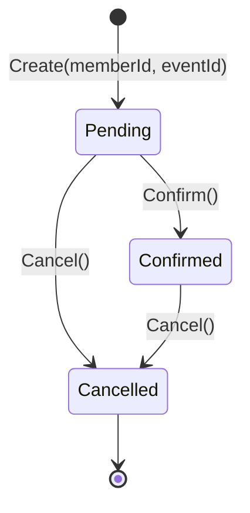

## Câu 1a

Bốn trụ cột của lập trình hướng đối tượng (OOP):

1. **Đóng gói (Encapsulation):** Gom dữ liệu (thuộc tính) và hành vi (phương thức) vào trong cùng một lớp, đồng thời che giấu dữ liệu nội bộ (`private set`) và chỉ cho phép thay đổi thông qua các phương thức kiểm tra hợp lệ của lớp.
   - *Minh hoạ trong bài:* Tệp `EduHub.Domain/Entities/Member.cs` (lớp `Member`) và tệp `EduHub.Domain/Entities/Registration.cs` (lớp `Registration`).

2. **Trừu tượng hoá (Abstraction):** Ẩn đi chi tiết cài đặt cụ thể bên dưới và chỉ định nghĩa các giao diện (interface) mô tả hệ thống cần làm gì.
   - *Minh hoạ trong bài:* Tệp `EduHub.Domain/Interfaces/IEventRepository.cs` (interface `IEventRepository`) và tệp `EduHub.Application/Interfaces/INotificationService.cs` (interface `INotificationService`).

3. **Kế thừa (Inheritance):** Cho phép lớp con kế thừa các thuộc tính và phương thức từ lớp cha để tái sử dụng mã nguồn.
   - *Minh hoạ trong bài:* Tệp `EduHub.API/Controllers/EventsController.cs` (lớp `EventsController` kế thừa từ lớp cơ sở `ControllerBase`).

4. **Đa hình (Polymorphism):** Cho phép các đối tượng thuộc các lớp khác nhau thực thi cùng một phương thức của interface theo nhiều cách khác nhau.
   - *Minh hoạ trong bài:* Tệp `EduHub.Infrastructure/Notifications/EmailNotificationService.cs` (lớp `EmailNotificationService`) và tệp `EduHub.Infrastructure/Notifications/SmsNotificationService.cs` (lớp `SmsNotificationService`) cùng cài đặt phương thức `Send(...)` của `INotificationService`.

## Câu 1b

Hai vấn đề làm lớp `Member` trong Đoạn mã 1 chưa đóng gói:
1. Các thuộc tính `Id` và `Email` có `public set`, cho phép bên ngoài tự ý gán giá trị không hợp lệ trực tiếp (ví dụ `m.Email = "abc"` không có ký tự `@`).
2. Constructor `public Member() { }` để công khai và không có tham số kiểm tra, cho phép tạo đối tượng `Member` ở trạng thái rỗng/không hợp lệ ngay từ đầu.

## Câu 2a

